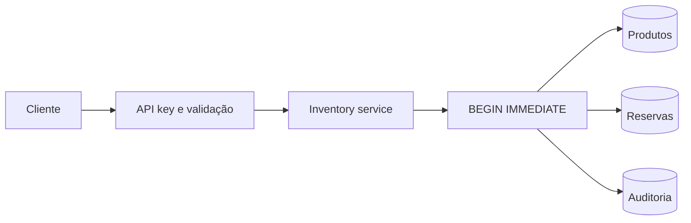

# Reserva API

API de reserva de estoque com NestJS, TypeScript e SQLite. O problema central é garantir disponibilidade quando várias requisições tentam reservar o mesmo item, inclusive depois de uma falha ou repetição do cliente.



## Regras do domínio

- O estoque disponível é o total restante menos as reservas ativas.
- Uma confirmação reduz o total uma vez; um cancelamento libera a reserva.
- Reservas vencidas são identificadas antes das operações de disponibilidade e escrita. A limpeza é sob demanda, sem cron.
- `Idempotency-Key` vincula a primeira reserva ao seu SKU, quantidade e TTL. Repetições retornam a mesma reserva, incluindo seu estado atual. A mesma chave com outro corpo retorna 409.
- Uma reserva expirada ou cancelada não pode ser confirmada. Uma confirmação repetida é idempotente.
- Auditoria e alteração do domínio são gravadas na mesma transação.

A transação `BEGIN IMMEDIATE` serializa a verificação de disponibilidade e a escrita em duas conexões ao mesmo arquivo. Isso evita o intervalo entre consultar o estoque e reservar. O WAL permite leitores durante a escrita; o timeout de contenção é de cinco segundos.

## Executar localmente

Requer Node.js 24+ e npm. O SQLite usa o módulo nativo do Node, sem instalação de banco ou chave de serviço externo.

```powershell
npm ci
npm run setup
npm run build
npm start
```

O comando `setup` cria um `.env` com segredos aleatórios e preserva um arquivo já existente. O arquivo é ignorado pelo Git. Na janela de outro terminal, rode `npm run demo` para executar um fluxo completo contra a API já iniciada.

- `GET /health` verifica se o processo está disponível.
- `/docs` abre o Swagger interativo.
- `/docs-json` expõe o contrato OpenAPI.
- `npm test` compila e executa testes HTTP reais com bancos temporários.
- `npm run format:check` verifica o padrão Prettier.
- `npm run dev` observa o JavaScript compilado. Rode `npx tsc --watch` em outro terminal para recompilar TypeScript durante o desenvolvimento.

## Docker

Depois de `npm run setup`:

```powershell
docker compose up --build
```

O container roda como usuário `node`, com volume de dados e porta publicada somente no loopback do host. O Dockerfile usa etapas de build e runtime. Os testes locais foram executados no Node 24 do Windows; a execução Docker depende de um daemon disponível.

## Endereços e autenticação

A API inicia na porta **4311**. Abra **http://localhost:4311/docs** e use o campo **Authorize** com o valor de `API_KEY` do seu `.env`. Os endpoints de domínio exigem `X-Api-Key`.

| Método | Rota | Comportamento |
|---|---|---|
| POST | /products | Cadastra SKU e estoque inicial |
| GET | /products/:sku | Consulta total, reservado e disponível |
| POST | /holds | Cria reserva; exige Idempotency-Key |
| POST | /holds/:id/confirm | Confirma e baixa estoque |
| POST | /holds/:id/cancel | Cancela e libera disponibilidade |
| GET | /holds/:id/audit | Consulta eventos da reserva |

Exemplo do corpo de uma reserva:

```json
{ "sku": "CAMISA-BAHIA-M", "quantity": 2, "ttlSeconds": 300 }
```

Cadastre o SKU antes. A quantidade é inteira, o TTL vai de 1 a 3600 segundos e campos desconhecidos são rejeitados. Estoque insuficiente ou transição inválida gera 409, SKU inexistente gera 404 e credencial inválida gera 401.

## O que os testes exercitam

Sete cenários verificam autenticação/validação, disputa por estoque em duas instâncias, replay e conflito de chave, confirmação repetida, cancelamento, expiração e persistência após reinício. A expiração usa atualização controlada do relógio da reserva no banco de teste; não depende de esperar minutos.

## Decisões e limites

O SQLite torna a demonstração reproduzível e mantém transações reais. A aplicação deve usar um disco local durável; não coloque o arquivo WAL em um volume de rede para escalar entre máquinas. Para uma operação distribuída, migraria o armazenamento para PostgreSQL com operações condicionais e testes concorrentes equivalentes.

A API key representa um integrador confiável. Não há cadastro de clientes, cobrança, catálogo visual nem isolamento por tenant neste serviço. Reservas não são pagamentos. O histórico pode crescer indefinidamente e precisa de uma política de retenção em uma operação real.

## Organização

`src/inventory.ts` concentra DTOs, controller e serviço de estoque; `src/database.ts` gerencia conexões e transações; `src/security.ts` valida a chave. A composição e o Swagger ficam em `src/app.ts`. A organização deixa as regras próximas e permite separar arquivos quando o domínio crescer.

Projeto de portfólio de Pedro Igor. Os cenários e os testes podem ser executados e discutidos a partir do código deste repositório.

## Evidências locais

- [Contrato OpenAPI exportado da aplicação](docs/openapi.json)
- [Resposta obtida ao executar a demonstração](docs/demo-response.json)

Os identificadores e horários no exemplo são de uma execução local. O fluxo pode ser repetido com o comando de demonstração. O Docker Desktop estava sem daemon na verificação local; apenas a configuração Compose foi validada.
